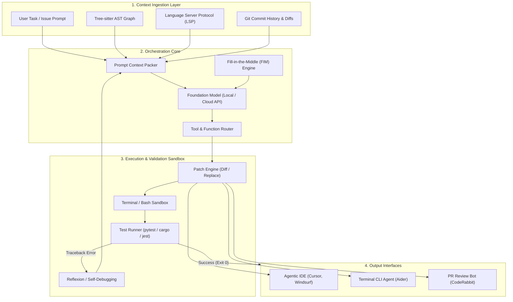
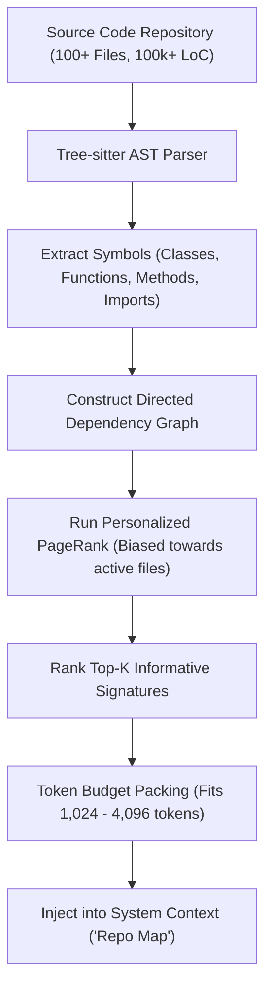

# AI Coding Benchmarks, System Architecture & Edit Representations

An empirical technical guide to evaluation benchmarks, agent system architectures, AST PageRank repo-mapping, and code editing representation trade-offs.

---

## 1. Standardized Public Benchmarks

### SWE-bench & SWE-bench Verified
- **Scope:** 2,294 real-world GitHub issues extracted from 12 popular open-source Python repositories (Django, SymPy, scikit-learn, etc.). SWE-bench Verified narrows this to 500 human-validated, non-leaked issue instances.
- **Evaluation:** Evaluates full repository modification. Candidate patches are tested against hidden test suites using `FAIL_TO_PASS` and `PASS_TO_PASS` verification.
- **Metric:** $pass@1$ percentage of resolved issues.

### HumanEval & HumanEval+
- **Scope:** 164 hand-crafted Python programming problems evaluating function-level docstring comprehension and unit-test completion.
- **HumanEval+:** Augments original test suites with 80x more mutation test cases (EvalPlus) to expose false-positive passes.

### MBPP (Mostly Basic Python Problems) & MBPP+
- **Scope:** 974 crowd-sourced Python programming challenges targeting algorithmic problem solving, string manipulation, and mathematical routines.

### CrossCodeEval
- **Scope:** Multi-file completion benchmark testing repository-level cross-file dependency comprehension across Python, Java, C#, and TypeScript.

---

## 2. SWE-bench Verified Official Benchmark Leaderboard

Empirical evaluation results sourced directly from the official [SWE-bench Verified Leaderboard](https://www.swebench.com) (500 human-validated real-world GitHub issues; last verified: 2026-11-09):

| Rank | Agent / System Architecture | Model | Resolved % ($pass@1$) | Avg Cost / Issue | Date | Source Link | Agent Open Source? |
| :---: | :--- | :--- | :---: | :---: | :---: | :---: | :---: |
| **1** | [Sonar Foundation Agent](https://www.sonarsource.com) | Claude 4.5 Opus | **79.2%** | N/A | 2025-12-05 | [SonarSource](https://www.sonarsource.com) | ❌ |
| **2** | [live-SWE-agent](https://github.com/OpenAutoCoder/live-swe-agent) | Claude 4.5 Opus | **79.2%** | N/A | 2025-12-15 | [GitHub](https://github.com/OpenAutoCoder/live-swe-agent) | ✅ |
| **3** | [TRAE](https://github.com/bytedance/trae-agent) | Doubao-Seed-Code | **78.8%** | N/A | 2025-09-28 | [ByteDance](https://github.com/bytedance/trae-agent) | ✅ |
| **4** | [live-SWE-agent](https://github.com/OpenAutoCoder/live-swe-agent) | Gemini 3 Pro Preview | **77.4%** | N/A | 2025-11-20 | [GitHub](https://github.com/OpenAutoCoder/live-swe-agent) | ✅ |
| **5** | [mini-SWE-agent](https://github.com/SWE-agent/SWE-agent) | Claude 4.5 Opus (high) | **76.8%** | $0.75 | 2026-02-17 | [SWE-bench](https://www.swebench.com) | ✅ |
| **6** | [mini-SWE-agent](https://github.com/SWE-agent/SWE-agent) | Gemini 3 Flash (high) | **75.8%** | $0.36 | 2026-02-17 | [SWE-bench](https://www.swebench.com) | ✅ |
| **7** | [mini-SWE-agent](https://github.com/SWE-agent/SWE-agent) | MiniMax M2.5 (high) | **75.8%** | $0.07 | 2026-02-17 | [SWE-bench](https://www.swebench.com) | ✅ |
| **8** | [Warp](https://www.warp.dev) | Multi-Model Harness | **75.6%** | N/A | 2025-09-01 | [Warp](https://www.warp.dev) | ❌ |
| **9** | [OpenHands](https://all-hands.dev/) | GPT-5 | **71.8%** | N/A | 2025-08-07 | [All-Hands](https://all-hands.dev/) | ✅ |
| **10** | [OpenHands](https://all-hands.dev/) | Qwen3-Coder-480B-A35B | **69.6%** | N/A | 2025-08-05 | [Qwen Blog](https://qwenlm.github.io/blog/qwen3-coder/) | ✅ |
| **11** | [SWE-agent](https://github.com/SWE-agent/SWE-agent) | Qwen3-Coder-480B-A35B | **55.4%** | $0.25 | 2025-08-02 | [SWE-bench](https://www.swebench.com) | ✅ |
| **12** | [OpenHands](https://docs.all-hands.dev/) | CodeAct v2.1 (Claude 3.5 Sonnet) | **53.0%** | N/A | 2024-10-29 | [OpenHands](https://docs.all-hands.dev/) | ✅ |

---

## 3. System Architecture & Context Assembly

Modern autonomous coding agents coordinate four decoupled architectural layers:

---

## 4. Tree-sitter & AST PageRank Repo-Maps

To ground models in large codebases without blowing past token budgets, systems like Aider construct dynamic repository maps using Tree-sitter and Personalized PageRank:

1. **AST Extraction:** Tree-sitter parses every source file into abstract syntax trees, identifying definitions and references.
2. **Graph Construction:** A directed call and import graph connects symbols across files.
3. **Personalized PageRank:** Importance is propagated through the graph, biased toward files currently referenced in the conversation or modified git worktrees.
4. **Context Packing:** The highest-ranked symbol signatures are formatted into a compact summary that fits in 1k–4k tokens.

---

## 5. Code Editing Representation Trade-offs

How an agent expresses code modifications significantly impacts speed, cost, and reliability across model sizes:

| Editing Format | Token Overhead | Small Model Success Rate (<14B) | Multi-Hunk Reliability | Computational Complexity | Primary Implementation |
| :--- | :---: | :---: | :---: | :---: | :--- |
| **Whole-File Rewrite** | Critical ($O(N)$ full file) | Moderate (Hallucinates long tails) | 100% (No alignment) | Minimal | Early ChatGPT / Copilot |
| **Search / Replace Blocks** | Low ($O(\Delta)$ hunk tokens) | High (>90% accuracy) | High (Anchored by exact match) | $O(N)$ string search | **Aider**, **Mentat**, **Cline** |
| **Unified Diff (`diff -u`)** | Minimal (Line metadata only) | Poor (<45% valid math) | Low (Fails hunk line counts) | Standard `patch` tool | Git / Diff utilities |
| **AST Tree Patching** | Low (Structural node diff) | High (Grammar constrained) | High (AST node replacement) | $O(\log N)$ Tree-sitter query | **Avante.nvim**, Academic Linters |
